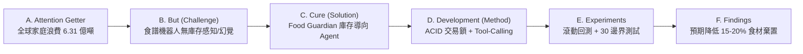
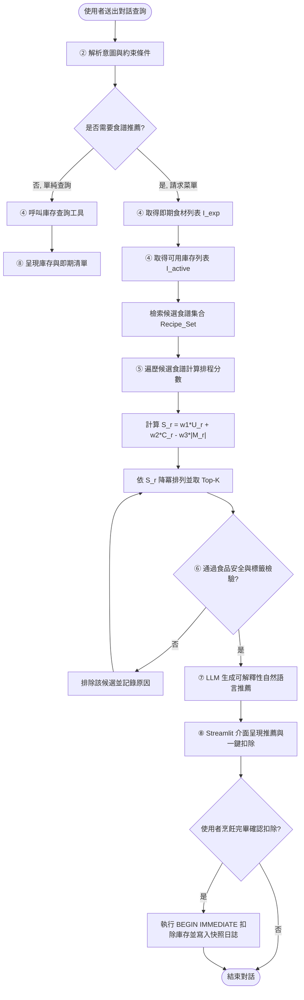

# DIC3: Food Guardian — Project Proposal Refactor using OpenSpec

> **物聯網期末專題提案 (Final Project Proposal) 規格驅動重構報告**  
> **核心主題**：庫存導向之 Domain AI Agent 系統 (Inventory-Driven Domain AI Agent)  
> **指導架構**：整合 Fission-AI OpenSpec (Spec-Driven Development, SDD) 與 A-Z SOP 標準學術論文架構規範

---


## 目錄 (Table of Contents)
- [DIC3: Food Guardian — Project Proposal Refactor using OpenSpec](#dic3-food-guardian--project-proposal-refactor-using-openspec)
  - [目錄 (Table of Contents)](#目錄-table-of-contents)
  - [專案簡介與課堂背景說明](#專案簡介與課堂背景說明)
  - [Part 1: OpenSpec 安裝與規格驅動開發 (Spec-Driven Development)](#part-1-openspec-安裝與規格驅動開發-spec-driven-development)
    - [1.1 什麼是 OpenSpec 與規格驅動開發 (SDD)？](#11-什麼是-openspec-與規格驅動開發-sdd)
    - [1.2 OpenSpec 在 Windows 系統的安裝與環境驗證](#12-openspec-在-windows-系統的安裝與環境驗證)
    - [1.3 專案目錄結構與 OpenSpec 架構整合](#13-專案目錄結構與-openspec-架構整合)
    - [1.4 OpenSpec 核心指令與變更生命週期](#14-openspec-核心指令與變更生命週期)
  - [Part 2: 專案核心論述：A to F 摘要、5 大核心思維、3 大專業爭論、10 個深度理解問題](#part-2-專案核心論述a-to-f-摘要5-大核心思維3-大專業爭論10-個深度理解問題)
    - [2.1 A to F 結構化摘要 (Abstract Story)](#21-a-to-f-結構化摘要-abstract-story)
    - [2.2 預期貢獻與學術價值 (Academic Value \& SDG 12.3)](#22-預期貢獻與學術價值-academic-value--sdg-123)
    - [2.3 領域專家 5 大核心思維模式 (5 Core Mindsets)](#23-領域專家-5-大核心思維模式-5-core-mindsets)
    - [2.4 領域 3 大重要專業爭論 (3 Controversies \& Trade-offs)](#24-領域-3-大重要專業爭論-3-controversies--trade-offs)
    - [2.5 10 個深度理解評量問題 (10 Deep Understanding Questions)](#25-10-個深度理解評量問題-10-deep-understanding-questions)
  - [Part 3: DESIGN.md 轉換為 OpenSpec 工作流程 (Workflow in OpenSpec)](#part-3-designmd-轉換為-openspec-工作流程-workflow-in-openspec)
    - [3.1 系統八大架構模組 (System Architecture ①～⑧)](#31-系統八大架構模組-system-architecture-)
    - [3.2 Agent 決策推理流程圖 (Flowchart)](#32-agent-決策推理流程圖-flowchart)
    - [3.3 核心演算法虛擬碼 (Algorithm 1: Domain AI Agent for Food Guardian)](#33-核心演算法虛擬碼-algorithm-1-domain-ai-agent-for-food-guardian)
    - [3.4 傳統 DESIGN.md 至 OpenSpec 規格驅動之演進](#34-傳統-designmd-至-openspec-規格驅動之演進)
  - [Part 4: Introduction 緒論重構 (Introduction Refactor - A–F 結構)](#part-4-introduction-緒論重構-introduction-refactor---af-結構)
    - [A. Attention Getter (權威數據引題)](#a-attention-getter-權威數據引題)
    - [B. Background (應用情境與技術背景)](#b-background-應用情境與技術背景)
    - [C. Problem (核心痛點與黑箱矛盾)](#c-problem-核心痛點與黑箱矛盾)
    - [D. Existing Limitations (既有系統瓶頸與研究缺口)](#d-existing-limitations-既有系統瓶頸與研究缺口)
    - [E. Innovation (本研究三大核心技術創新)](#e-innovation-本研究三大核心技術創新)
    - [F. Contributions (學術與技術貢獻清單)](#f-contributions-學術與技術貢獻清單)
  - [Part 5: Related Work 相關研究重構 (Related Work Refactor)](#part-5-related-work-相關研究重構-related-work-refactor)
    - [5.1 AI 技術核心 (1/2 AI Technology)](#51-ai-技術核心-12-ai-technology)
    - [5.2 食品領域知識 (1/2 Domain Know-how)](#52-食品領域知識-12-domain-know-how)
    - [5.3 標準文獻綜述對照表 (Article Summary Table)](#53-標準文獻綜述對照表-article-summary-table)
    - [5.4 文獻演進與研究缺口推導邏輯鏈](#54-文獻演進與研究缺口推導邏輯鏈)

---

## 專案簡介與課堂背景說明

本專案對應物聯網課程之**期末專題提案 (Final Project Proposal, 10%)** 與 Handover 要求。本專案不只做一個模型，也不做純閒聊的 Chatbot，而是構建一個**懂領域、會取資料、能推理並具備客觀驗證基礎的 Domain AI Agent** —— **Food Guardian (庫存導向之智慧食材管理代理人)**。

在課堂中，我們實踐了兩段式提示詞工程方法論：
1. **第一段 (NBLM & ChatGPT)**：透過標準 A-Z SOP 論文架構與提案作業規範，對專案結構進行深度剖析與 A4 橫式資訊圖表化。
2. **第二段 (Perplexity 深度查證)**：針對主題進行嚴格查核，引入 2024–2026 年最新權威數據（聯合國環境署 UNEP《Food Waste Index Report 2024》、FAO 糧農組織統計），使研究動機具備 **Interesting（引人入勝）、Innovation（技術創新）與 Important（重大社會與學術價值）** 之特質，並針對 A 至 F（Attention Getter → But → Cure → Development → Experiments → Findings）進行嚴謹補強。

本文件使用 **Fission-AI/OpenSpec** 進行規格驅動重構（Spec-Driven Development），建立高可靠度、可追蹤與可驗證之期末交付基線。

---

## Part 1: OpenSpec 安裝與規格驅動開發 (Spec-Driven Development)

### 1.1 什麼是 OpenSpec 與規格驅動開發 (SDD)？
傳統 AI 輔助軟體開發常落入「Prompt-and-Pray」（隨機提問並祈禱程式碼可用）的陷阱，導致規格發散、產生幻覺 API、破壞架構一致性。
**Spec-Driven Development (SDD, 規格驅動開發)** 提出將「規格 (Specifications)」作為系統唯一事實來源 (Single Source of Truth, SSOT)：
1. **規格優先 (Spec-First)**：先釐清系統外部可觀測行為 (Behavior Contracts)，嚴禁直接跳入寫程式碼。
2. **變更提議 (Proposals & Deltas)**：所有的架構與功能調整均需以 `openspec new change` 形式發起，產出 `proposal.md`、`specs/`（增量 Delta）、`design.md` 與 `tasks.md`。
3. **機器與人工雙重可驗證**：透過 `openspec validate` 保證規格語法與情境測試（Scenario）的完備性，再由 Agent 精準實現程式碼。

### 1.2 OpenSpec 在 Windows 系統的安裝與環境驗證
OpenSpec 提供跨平台的 CLI 工具，在 Windows 環境中支援獨立安裝（不需預先安裝 Node.js）與 npm 安裝。

#### 官方推薦安裝方式 (Windows Standalone PowerShell)：
```powershell
irm https://openspec.dev/cli/install.ps1 | iex
```
*(備註：若系統已安裝 Node.js v20.19.0+，亦可使用 `npm install -g @fission-ai/openspec@latest`)*

#### 環境驗證：
```powershell
openspec --version
# 輸出驗證: 1.17.0
```

### 1.3 專案目錄結構與 OpenSpec 架構整合
執行 `openspec init --tools antigravity` 初始化後，專案具備完整 SDD 結構：

```text
DIC3/
├── .agents/                        # AI 代理人工作流與技能庫
│   ├── skills/                     # OpenSpec 專用技能
│   │   ├── openspec-propose/       # 提議生成技能
│   │   ├── openspec-apply-change/  # 規格落實變更技能
│   │   └── openspec-archive-change/# 變更封存技能
│   └── workflows/                  # 代理人操作工作流定義
│       ├── opsx-propose.md         # /opsx-propose 流程
│       └── opsx-apply.md           # /opsx-apply 流程
├── openspec/                       # OpenSpec 核心規格儲存庫
│   ├── config.yaml                 # 專案 SDD 設定檔
│   ├── specs/                      # 系統現行有效之正式規格 (Main Specs)
│   │   ├── inventory-engine/       # 庫存交易引擎規格
│   │   └── agent-dispatch/         # Agent 決策調度規格
│   └── changes/                    # 進行中的變更提案 (In-flight Changes)
│       ├── proposal-refactor/      # 本次 Proposal 重構變更
│       │   ├── proposal.md         # 變更動機與能力清單
│       │   ├── specs/              # 本次變更之 Delta 規範
│       │   ├── design.md           # 技術設計與架構考量
│       │   └── tasks.md            # 可追蹤之實作任務清單
│       └── archive/                # 已完成封存之歷史變更
├── DESIGN.md                       # 專題核心系統設計文件 (A-Z SOP 規範)
├── README.md                       # 專案總覽與重構論述文件 (本文件)
└── (A-F)...docx, 系統設計解析.pdf    # 原始專案需求與學術審查報告
```

### 1.4 OpenSpec 核心指令與變更生命週期
| 指令 | 說明 | 適用時機 |
| :--- | :--- | :--- |
| `openspec init` | 於專案中初始化 OpenSpec 配置 | 專案初次採用 SDD 時 |
| `openspec new change "<name>"` | 建立新的變更目錄與骨架 | 提出新功能或大規模重構前 |
| `openspec status --change "<name>"` | 檢視該變更的構想與檔案完成狀態 | 追蹤提案與規格進度 |
| `openspec validate <name>` | 嚴格語法與情境完整性校驗 | 驗證規格是否合規 |
| `openspec archive <name>` | 將完成的變更增量併入主規格庫 | 任務實作並驗收完畢時 |
| `openspec doctor` | 診斷專案中 OpenSpec 結構與關聯性健康度 | 確保專案規格相依關係正常 |

---

## Part 2: 專案核心論述：A to F 摘要、5 大核心思維、3 大專業爭論、10 個深度理解問題

### 2.1 A to F 結構化摘要 (Abstract Story)



- **A. Attention Getter（研究動機與權威數據）**：  
  聯合國環境署（UNEP）最新《Food Waste Index Report 2024》統計，全球每年在消費端浪費達 **10.5 億公噸（1.05 billion tonnes）** 食物，佔人類可食用食物的 **19%**（每五份食物就有一份被拋棄）。其中，**家庭端高達 6.31 億公噸（佔總浪費量 60%）**，人均每年浪費 **79 公斤** 食材，造成全球每年逾 **1 兆美元** 之經濟浩劫；而在世界另一端，仍有 7.83 億人口遭受長期飢餓威脅（FAO 2024）。家庭食材因遺忘、過期與過量採買造成的浪費，是迫切需要介入的關鍵痛點。
- **B. But（核心挑戰與 Research Gap）**：  
  家庭是食物浪費最大來源，然而市面上之食譜機器人（如 ChatGPT 或傳統 RAG 系統）僅能依使用者當下輸入的幾項偏好進行菜單推薦，**完全脫節於冰箱內部真實的動態庫存、數量、包裝開封狀態與保存期限**。這導致使用者仍頻繁重複採買或任由食材過期腐壞。近期 ZeroWasteAI 等先導研究顯示，引入動態提醒可將家庭浪費率從 31.3% 降至 23.0%（降幅 26.5%）；但現有系統仍**缺乏微觀資料庫 ACID 交易保護**，並**缺乏可解釋的「即期優先權（Expiring-First）」多目標排程機制**，未能形成採買、烹飪、過期到處置的閉環生命週期管理。
- **C. Cure（提出解方）**：  
  為解決上述研究缺口，本專題提出 **Food Guardian: 庫存導向之 Domain AI Agent 系統**。本系統以實體動態庫存為唯一核心，整合食材即期預警、多目標即期消耗餐點推薦、採買清單自適應修正與自動化庫存核銷。
- **D. Development（系統實作方法）**：  
  系統採用 Streamlit 作為前端互動介面；Service Layer 封裝日期邊界劃分、多目標評分排程與缺料比對；資料庫管理層利用 SQLite 之 `BEGIN IMMEDIATE` 獨佔寫入鎖實現微觀 ACID 交易保護；Agent Adapter Layer 則透過白名單 Tool-Calling 驅動大語言模型進行可解釋性自然語言推理，嚴格杜絕「幽靈食材」幻覺。
- **E. Experiments（評估計畫與基準線）**：  
  規劃 2024–2026 模擬家庭食材日誌滾動回測，設計 30+ 組涵蓋資料異常、極限到期與並行併發的極限情境測試。實驗設立三組對照基準：
  - *Baseline 1 (Random Selection)*：隨機食譜抽取
  - *Baseline 2 (Pure LLM Generative)*：純生成式 LLM（無資料庫工具鏈接）
  - *Baseline 3 (Our Method)*：Food Guardian Domain AI Agent  
  量化評估指標包含：庫存盤點正確率 (Inventory Accuracy %)、即期食材利用率 (Expiring Utilization Rate %)、家庭廢棄率降幅 (Waste Reduction %)、重複購買率 (Repeated Purchase Rate %) 與推薦採納率 (Acceptance Rate %)。
- **F. Findings（預期成果，提案階段絕不虛構數據）**：  
  嚴格遵循提案規範，本提案僅列 Expected Outcomes：預估 Food Guardian 能達成 **15%～20%** 之家庭食材廢棄降幅，庫存盤點正確率達 **95% 以上**，實現 **100% 來源揭露（Source Attribution）** 與 **0% 超額扣除（Zero Over-deduction）**，驗證實體庫存與 AI Agent 閉環之工程可行性。

---

### 2.2 預期貢獻與學術價值 (Academic Value & SDG 12.3)
1. **對應聯合國永續發展指標 SDG 12.3**：直接針對 UNEP 報告所揭露之家庭端 6.31 億公噸（60%）食物浪費問題，提供可落地的工程解決方案，為 2030 年全球人均浪費減半目標做出實務貢獻。
2. **開創「庫存為先 (Inventory-First)」的 Agent 典範**：打破傳統問答聊天機器人（Chatbot）模式，將 LLM 限制於白名單工具呼叫與可解釋性生成，底層由 ACID 交易資料庫與啟發式數學模型支撐，兼顧 AI 靈活性與資料嚴肅性。
3. **建立家庭食材生命週期閉環稽核機制**：透過事件快照日誌（Snapshot Logging），確保使用者即使刪除或修正項目，歷史浪費與消費紀錄仍具備 100% 可追溯性。

---

### 2.3 領域專家 5 大核心思維模式 (5 Core Mindsets)

1. **思維一：庫存狀態即動態交易 (Inventory as Transaction)**  
   - *內涵*：食材在家庭儲存過程中具有嚴格的「物質不滅」與「資產屬性」。食材數量不可被視作純文字對話中的虛擬變數，每次烹調消耗、過期倒掉或重複補充，均為具備狀態轉移（active / consumed / wasted）的資料庫交易。
   - *證據與影響*：傳統 App 常發生使用者多按一次或並行請求導致剩餘數量為負值（超扣 Over-deduction）。系統必須採用資料庫層級的寫入排他鎖（`BEGIN IMMEDIATE`），杜絕併發扣庫存異常。
2. **思維二：標示日期不等於安全絕對界線 (Date Label vs. Safety Gate)**  
   - *內涵*：食品標籤上的「有效日期 (Use By)」代表衛生安全邊界，過期即存在致病菌與毒素風險；而「最佳賞味期限 (Best Before / 賞味期限)」僅代表風味、口感與外觀的最佳狀態。
   - *證據與影響*：歐盟與英國食品標準局統計，高達三分之一的家庭食物浪費源於民眾誤解 Best Before 而將完好食物丟棄。系統在提醒時嚴格區分標籤語意，引導使用者進行感官檢查（Sensory Check），避免盲目棄置。
3. **思維三：即期優先於完整匹配 (Expiring First Over Perfect Match)**  
   - *內涵*：在烹飪排程中，「消耗即將變質的食材」其環境與經濟效益遠高於「完美執行一道高難度或需額外採買大量材料的複雜大餐」。
   - *證據與影響*：若推薦系統只追求庫存覆蓋率 100%，系統往往傾向推薦調味料齊全但無法消耗剩餘半顆洋蔥或即期鮮奶的菜單。演算法必須將即期利用量（$U_r$）賦予最高加權權重。
4. **思維四：快照稽核與浪費可追溯性 (Snapshot Logging for Traceability)**  
   - *內涵*：食材計量涉及質量（g/kg）、體積（ml/L）與離散計數（顆/條/包），且食材隨時間會被編輯或刪除。浪費分析必須基於處置當下的實體狀態快照。
   - *證據與影響*：若資料庫直接使用外鍵串聯 `items.id`，一旦使用者手動清除過期項目，歷史統計將遺失單位與品名。系統設計獨立快照表 `consumption_waste_logs`，並在應用層嚴禁跨不可換算單位直接相加。
5. **思維五：可解釋的推薦理由 (Explainable Recommendation)**  
   - *內涵*：AI Agent 不應是個黑箱推薦器，必須主動向使用者揭露決策邏輯：「這道菜消耗了您後天過期的 200g 豬肉，且冰箱已有青蔥與醬油，您只需順路購買一盒豆腐」。
   - *證據與影響*：可解釋性大幅提高使用者的信任度與採納率（Acceptance Rate），並使使用者清楚認知自己的採買清單差異。

---

### 2.4 領域 3 大重要專業爭論 (3 Controversies & Trade-offs)

#### 爭論一：食品安全判定應採用「嚴格日期硬性截斷」或「感官與保存條件動態評估」？
- **觀點 A（硬性截斷派）**：只要系統時間超過資料庫登錄之到期日，系統即刻強制將食材標記為不可食用並拒絕推薦，避免使用者食物中毒之潛在法律與健康風險。
- **觀點 B（動態評估派）**：家庭冷凍冷藏環境各異，大量 Best Before 食材過期數天在冷藏完好情況下依然完全安全。硬性截斷將直接違背「減少食物浪費」之專案初衷。
- **雙方有力證據**：觀點 A 有食品衛生法規與致病菌繁殖實驗數據支持；觀點 B 有 USDA FoodKeeper 與 WRAP 報告支持（家庭中大量牛奶、麵包過期一天仍可食用）。
- **當前共識與解法**：系統採取**分級警示而非武斷裁決**。若為 Use By 嚴格過期，系統直接阻斷推薦；若為 Best Before，系統標示「風味可能下降，請確認外觀無發霉、無異味後優先煮熟食用」，將最終決策權回歸人類。

#### 爭論二：食材庫存輸入應採用「自動 Computer Vision 辨識」還是「手動/文字 Service 驗證」？
- **觀點 A（Vision 辨識派）**：使用者極度抗拒手動輸入庫存，透過手機拍照冰箱內部或掃描購物發票 OCR，才能提供順暢的使用者體驗。
- **觀點 B（手動驗證派）**：目前單眼相機無法穿透塑膠袋與保鮮盒，更無法辨識包裝背面極微小的有效日期；一旦初始庫存錯誤（Garbage in, Garbage out），後續所有推薦均為空中樓閣。
- **共識與技術取捨**：在第一階段（Proposal 與原型）堅持以**手動驗證與標準結構化表單**為基準，確保資料庫品質具備 100% 正確性；待核心 Agent 推理與交易鏈路成熟後，第二階段再引入 Vision 作為輔助輸入工具。

#### 爭論三：食譜推薦決策應由「LLM 自由生成」還是「Domain 庫存硬性過濾」？
- **觀點 A（LLM 自由生成派）**：大語言模型具有極高創意，能處理家庭廚房剩餘零碎食材的即興混搭（如剩菜烘蛋），死板的食譜資料庫無法應對非典型剩料。
- **觀點 B（Domain 庫存過濾派）**：自由生成常出現幻覺，憑空捏造家中沒有的特殊香料或危險烹調搭配（如未煮熟四季豆）。
- **共識與混合架構**：採用**兩階段混合架構 (Two-stage Hybrid Architecture)**。第一階段由 Python 領域規則引擎比對實體資料庫，篩選出符合庫存覆蓋率與即期利用之候選菜譜；第二階段再交由 LLM 進行剩料調配優化、步驟調整與說服性推薦理由生成。

---

### 2.5 10 個深度理解評量問題 (10 Deep Understanding Questions)

1. **[Why - 併發防護]** 為何在庫存扣除時，使用標準 SQLite `UPDATE` 不足以保證資料一致性，而必須顯式宣告 `BEGIN IMMEDIATE` 獨佔寫入鎖？
   > *解析*：在多分頁瀏覽或家庭成員同時操作的情境下，標準交易在讀取階段為共享鎖，若兩個請求同時讀取庫存數量為 1 並嘗試扣除 1，將引發競態條件（Race Condition）並導致超額扣減。`BEGIN IMMEDIATE` 在交易開始時即取得保留鎖，保證序列化執行。
2. **[What-if - 孤兒紀錄]** 若使用者手動刪除了一筆已記錄過期棄置的食材項目，歷史浪費統計分析會否失真？
   > *解析*：不會。系統設計了解耦的 `consumption_waste_logs` 表，刪除項目僅使日誌中的外鍵 `item_id` 設為 NULL（`ON DELETE SET NULL`），而處置當時的 `item_name_snapshot`、`quantity_snapshot` 與 `unit_snapshot` 均已永久保存。
3. **[Trade-off - 推薦平衡]** 在多目標計分演算法 $S_r = (w_1 \cdot U_r) + (w_2 \cdot C_r) - (w_3 \cdot |M_r|)$ 中，若將 $w_1$（即期食材利用）設得極高，可能引發何種使用者體驗副作用？
   > *解析*：可能導致系統為了強行消耗即期食材，推薦出怪異或難以入口的極端混搭菜色，或為了消耗 10g 即期九層塔而要求使用者採買昂貴的主料。因此需設定 $w_3$（缺少食材懲罰）與最低覆蓋率門檻進行制衡。
4. **[Failure Case - LLM 工具失敗]** 當 LLM 意圖解析錯誤，在 Tool-calling 中傳遞了不存在的食材名稱或負數數量時，系統如何降級保護？
   > *解析*：Agent Adapter 層具備嚴格的 Pydantic 結構驗證與白名單過濾器。一旦工具參數校驗失敗，系統中斷資料庫操作，向 LLM 回傳標準錯誤 JSON，觸發 Agent 的自我修正（Self-Correction）或直接向使用者請求釐清。
5. **[Evidence - 效果驗證]** 提案中如何以客觀數值證明 Food Guardian 的即期演算法優於純大語言模型推薦？
   > *解析*：透過離線回測矩陣對比。在相同模擬冰箱庫存（含 3 筆即期品）下，計算 Our Agent 推薦菜單之即期食材利用率（$U_r$）與幻覺食材率，與 Baseline 2 (Pure LLM) 進行雙尾 t 檢定。
6. **[Comparison - 與 RAG 之本質差異]** 本系統的架構與市面上常見的「食譜向量資料庫 RAG」有何本質上的不同？
   > *解析*：傳統 RAG 僅做語意相似度檢索（Semantic Retrieval），只管食譜文本與查詢像不像；Food Guardian 則是**狀態驅動的交易代理人 (State-driven Transactional Agent)**，核心在於查詢動態資料庫實體狀態、執行數學排程、驗證安全規則，並回寫庫存異動。
7. **[Design Decision - 單體 vs 微服務]** 專題為何選擇將 Streamlit、Service 與 SQLite 整合於單體架構（Monolithic），而非拆分為 FastAPI + PostgreSQL 微服務？
   > *解析*：針對期末專題範疇與邊緣桌面/家用環境，單體架構消除了網路延遲、分散式交易（Distributed Transaction 2PC）與多容器部署的複雜度，使驗收與 Handover 具備最高的可重現性（Reproducibility）。
8. **[Real-world Scenario - 單位不相容]** 冰箱有「2 顆雞蛋」與「100 ml 牛奶」，食譜需求為「50 g 雞蛋」與「1 杯牛奶」，系統如何避免直接數學累加引發的混亂？
   > *解析*：系統在領域知識庫中維護標準食材單位換算表（Density & Average Weight Lookup）。對於無法可靠換算的非標準單位，系統在介面顯示離散提醒，禁止跨單位進行浮點數扣除。
9. **[Boundary Condition - 標籤與安全衝突]** 若冷凍庫內有一塊標示過期半年的牛排，但文獻指出妥善冷凍可長期抑制微生物，Agent 該如何給出建議？
   > *解析*：Agent 調用 USDA FoodKeeper 規則庫，指出在持續 $-18^\circ\text{C}$ 冷凍下食品在微生物學上是安全的，但油脂氧化可能導致嚴重油耗味（Freezer Burn），因此推薦高溫燉煮或醬燒處置，而非作為高檔排餐。
10. **[Traceability - 閉環管理]** 什麼是專案中所強調的「採買、烹飪、過期到棄置的生命週期閉環」？
    > *解析*：食材由「採買輸入（產生 active 庫存）」→「Agent 推薦烹飪（扣除庫存並標記 consumed）」→「若未食用觸發即期預警」→「若最終損壞則手動註銷（標記 wasted 並紀錄原因）」。所有食材去向均有帳可查，不留無法統計的黑洞。

---

## Part 3: DESIGN.md 轉換為 OpenSpec 工作流程 (Workflow in OpenSpec)

### 3.1 系統八大架構模組 (System Architecture ①～⑧)

在系統設計中，模組以 ① 至 ⑧ 嚴格編號並貫穿資料流：

```text
┌────────────────────────────────────────────────────────────────────────┐
│                        Food Guardian 系統架構圖                        │
└────────────────────────────────────────────────────────────────────────┘

  ① User/Application Scenario (家庭冰箱管理、晚餐烹飪決策、浪費盤點)
                     │
                     ▼
  ② Query/Input (自然語言 Prompt:「冰箱有快過期的豬肉，今晚能煮什麼？」)
                     │
                     ▼
  ③ Planner & Reasoning Agent (意圖解析、任務分解、決定工具調用清單)
                     │
         ┌───────────┴───────────┐
         ▼                       ▼
  ④ Data Acquisition/Retrieval   ⑥ Domain Knowledge Integration
     - query_expiring_items()       - USDA FoodKeeper 規範庫
     - query_active_inventory()     - Use By vs. Best Before 標籤規則
         │                       │
         └───────────┬───────────┘
                     │
                     ▼
  ⑤ Analytics Engine (多目標排程、庫存覆蓋率 C_r、即期利用量 U_r 計分)
                     │
                     ▼
  ⑦ Decision / Recommendation (產生結構化建議物件：菜譜、缺料清單、推薦理由)
                     │
                     ▼
  ⑧ Output & Interaction (Streamlit UI 渲染、使用者一鍵確認扣庫存交易)
```

---

### 3.2 Agent 決策推理流程圖 (Flowchart)



---

### 3.3 核心演算法虛擬碼 (Algorithm 1: Domain AI Agent for Food Guardian)

```text
Algorithm 1: Domain AI Agent for Food Guardian
Input : User Query Q, Inventory Database State S_db, Knowledge Base K_domain
Output: Structured Recommendation R, Tool Execution Logs L

01: Receive user query Q from Streamlit interface
02: Parse query intent I and context constraints (e.g., expiry_priority = True)
03: Initialize agent planner and tool context container L
04: Call tool query_expiring_items(days_threshold = 3) to fetch expiring item set I_exp
05: Call tool query_active_inventory() to fetch full active inventory set I_active
06: Retrieve candidate recipes Recipe_Set from database or recipe service
07: foreach recipe r in Recipe_Set do
08:     Compute Inventory Coverage C_r = |Ingredients(r) ∩ I_active| / |Ingredients(r)|
09:     Compute Expiring Utilization U_r = |Ingredients(r) ∩ I_exp|
10:     Compute Missing Ingredients M_r = Ingredients(r) \ I_active
11:     Assign Score S_r = (w1 * U_r) + (w2 * C_r) - (w3 * |M_r|)
12: end for
13: Sort Recipe_Set by Score S_r descending
14: Select top-k candidate recipes R_candidates
15: Filter R_candidates using Domain Knowledge K_domain for food safety and label constraints
16: Construct LLM prompt with R_candidates, I_exp, and missing ingredients list M_r
17: Invoke LLM reasoning engine to produce natural language explanation and rationale
18: Formulate final response structure R = {Recommended_Recipes, Expiring_Used, Missing_Items, Rationale}
19: Append execution traces to log L
20: return R
```

- **計分公式參數定義**：
  $$S_r = (w_1 \cdot U_r) + (w_2 \cdot C_r) - (w_3 \cdot |M_r|)$$
  - $U_r = |Ingredients(r) \cap I_{exp}|$：食譜中消耗即期食材之項數（加權係數 $w_1 = 3.0$）
  - $C_r = \frac{|Ingredients(r) \cap I_{active}|}{|Ingredients(r)|}$：現有庫存對該食譜食材之覆蓋比率（加權係數 $w_2 = 2.0$）
  - $M_r = Ingredients(r) \setminus I_{active}$：該食譜尚缺乏之食材項數（懲罰係數 $w_3 = 1.5$）

---

### 3.4 傳統 DESIGN.md 至 OpenSpec 規格驅動之演進

| 面向 | 傳統靜態 DESIGN.md | OpenSpec 規格驅動開發 (SDD) |
| :--- | :--- | :--- |
| **文件本質** | 一次性編寫的靜態長文本，隨開發容易失效（Document Drift） | 作為可執行的規格合約 (Living Behavior Contracts)，隨 PR 動態演進 |
| **模組邊界** | 所有元件混雜於單一檔案中，上下文過長易超出 LLM Context Window | 依職責拆分為模組化規格目錄 (`specs/inventory-engine/`, `specs/agent-dispatch/`) |
| **變更管理** | 透過 Git Diff 查看文字修改，無法辨識行為層級的更動 | 透過 Delta 規範明確標註 `ADDED Requirements`、`MODIFIED Requirements` |
| **自動校驗** | 無語意檢查工具，靠人工肉眼審查 | 透過 `openspec validate` 進行情境語法（GIVEN/WHEN/THEN）自動化檢查 |

在 OpenSpec 工作流中，系統設計以四大產物循序推進：
$$\text{proposal.md (Why \& What)} \longrightarrow \text{specs/ (Behavior Contracts)} \longrightarrow \text{design.md (How)} \longrightarrow \text{tasks.md (Action Steps)}$$

---

## Part 4: Introduction 緒論重構 (Introduction Refactor - A–F 結構)

### A. Attention Getter (權威數據引題)
食物浪費已成為 21 世紀全球最嚴重的資源錯置與環境危機之一。依據聯合國環境署（UNEP）發布之《Food Waste Index Report 2024》，2022 年全球在零售、餐飲與家庭消費端所造成的糧食浪費總量高達 **10.5 億公噸（1.05 billion tonnes）**，佔全球可供食用糧食總量之 **19%**。尤為值得關注的是，**家庭端浪費高達 6.31 億公噸，佔整體浪費份額的 60%**，全球平均每人每年在家庭中丟棄 **79 公斤** 食物。這些被浪費的食物不僅每年造成全球超過 **1 兆美元** 之經濟損失，更伴隨著巨額的水資源耗竭與溫室氣體排放；與此同時，全球仍有約 **7.83 億人口正面臨飢餓**（FAO 2024）。數據顯示，食物浪費的最大破口不在於供應鏈運輸，而在於「家戶內部管理」。

### B. Background (應用情境與技術背景)
在現代都會生活中，雙薪家庭與年輕專業人士的生活節奏緊湊，採買模式往往以週末大賣場批發採購或線上生鮮電商配送為主。大量食材進入冰箱後，由於包裝堆疊、欠缺標籤分類與缺乏即時動態追蹤，使用者極易「遺忘」已購入的食材。另一方面，生成式人工智慧（Generative AI）與大語言模型（LLM）技術突飛猛進，使得建構具備自然語言理解與規劃能力的「領域智慧代理人（Domain AI Agent）」成為可能，為家庭食材數位化管理帶來了全新契機。

### C. Problem (核心痛點與黑箱矛盾)
家庭食物浪費的核心癥結在於：**物理實體庫存的衰變週期與數位烹飪決策之間的嚴重脫節**。多數家庭在規劃晚餐時，並非缺乏食譜，而是無法在「現有即期庫存」與「美味餐點」之間建立最優排程。當食材接近過期時，使用者往往因為缺乏針對即期食材的動態調配方案，最終選擇外食或再次採買，任由原本完好的食材在冷藏庫深處發霉腐敗。

### D. Existing Limitations (既有系統瓶頸與研究缺口)
現有解決方案在實務應用中均存在顯著盲區：
1. **傳統手動記帳 App**（如一般冰箱管理軟體）：需要使用者逐筆維護數量與手動扣除，認知負荷過重，往往在兩週內被使用者放棄；且缺乏智能推薦引擎，無法主動轉化為行動建議。
2. **純生成式 LLM 聊天助手**（如 ChatGPT、通用烹飪 Bot）：缺乏實體資料庫連線，推薦食譜時極易產生「幽靈食材幻覺」（推薦冰箱中根本沒有的昂貴香料），且完全不知道庫存有效日期，無法達成「搶救即期」的目標。
3. **高檔智慧冰箱電腦視覺方案**：依賴內部攝影機與物件偵測（Object Detection），但受限於保鮮盒遮蔽、多層堆疊與包裝袋反光，辨識準確率低於 88%，且根本無法讀取包裝背面微小的保存期限標籤。
4. **現有學術研究缺口 (Research Gap)**：雖然 ZeroWasteAI 等研究證明了提醒機制的潛力，但文獻中普遍缺乏將**微觀 ACID 交易保護**、**可解釋即期優先多目標排程**與**大模型白名單工具調用**整合於單一 Agent 的完整系統實踐。

### E. Innovation (本研究三大核心技術創新)
針對既有瓶頸，本專題提出三大關鍵創新：
1. **ACID 交易級實體庫存防護架構**：使用 SQLite `BEGIN IMMEDIATE` 獨佔寫入鎖與 Python Decimal 精確運算，杜絕多並行扣除導致的數量透支（Over-deduction），並透過事件快照日誌實現處置過程之可審計性。
2. **雙權重即期優先多目標啟發式演算法**：設計公式 $S_r = (w_1 \cdot U_r) + (w_2 \cdot C_r) - (w_3 \cdot |M_r|)$，在滿足最高庫存覆蓋率的前提下，最大化即期食材消耗，並最小化額外採買成本。
3. **白名單限制之可解釋 Domain AI Agent**：將大語言模型限制於受檢驗的工具呼叫（Tool-calling）與自然語言說服性理由包裝，徹底排除「幻覺生成」，使每一項推薦皆具備可驗證的事實依據。

### F. Contributions (學術與技術貢獻清單)
1. **架構貢獻**：提出首個結合單體交易鎖、白名單 Tool-calling 與食品保存領域規則的 Domain AI Agent 8 步驟參考架構。
2. **演算法貢獻**：形式化定義即期優先多目標排序函數，並提供帶行號之完整虛擬碼（Algorithm 1），建立客觀實驗對比基準。
3. **工程與實務貢獻**：採用 OpenSpec 規格驅動開發方法，建立包含 30+ 極限情境測試之驗證矩陣，完整支援聯合國永續發展目標 SDG 12.3。

---

## Part 5: Related Work 相關研究重構 (Related Work Refactor)

依據專題提案規範，相關研究嚴格涵蓋 **1/2 AI Technology（人工智慧技術）** 與 **1/2 Domain Know-how（領域專門知識）**。

### 5.1 AI 技術核心 (1/2 AI Technology)
1. **大語言模型工具調用與 Agent 架構 (Tool-Augmented LLMs)**：自 ReAct (Yao et al., 2023) 與 Toolformer (Schick et al., 2023) 提出以來，讓語言模型呼叫外部 API 已成為抑制模型幻覺的標準範式。本專案借鑑白名單 Function Calling 機制，將 Agent 的行為邊界嚴格限定於資料庫查詢與受控演算法，確保推薦結果百分之百來自真實庫存。
2. **多目標排程與啟發式決策 (Multi-Objective Optimization)**：在資源受限的動態排程問題中，貪婪演算法（Greedy Search）結合加權評分函數能有效兼顧即時性與求解質量。本研究引入雙權重啟發式排序，在毫秒級時間內完成數百道食譜與庫存集合的交集計算。

### 5.2 食品領域知識 (1/2 Domain Know-how)
1. **食品保存科學與保質期動態 (Food Shelf-life Dynamics)**：食品的品質衰退通常遵循一階化學反應動力學（Arrhenius Model），溫度與包裝狀態對微生物繁殖具決定性影響。美國農業部（USDA FoodKeeper）建立了超過 600 種常見食材在冷藏、冷凍與室溫下的衰變基準，成為本專案知識庫之核心來源。
2. **食品標籤標準與法規語意 (Date Labeling Taxonomy)**：依據國際食品法典委員會（Codex Alimentarius）與台灣食藥署規範，「有效日期 (Use By)」屬於安全截斷閥，逾期不得食用；而「最佳賞味期限 (Best Before)」涉及感官品質（Sensory Quality）。本專案在專家規則庫中對兩者進行嚴格的邏輯分支處理。

### 5.3 標準文獻綜述對照表 (Article Summary Table)

| Ref. | Year | Problem (研究問題) | AI Method (AI 方法) | Domain Knowledge (領域知識) | Dataset (使用資料集) | Findings (研究產出) | Limitation (既有局限性) |
| :---: | :---: | :--- | :--- | :--- | :--- | :--- | :--- |
| **[1]** | 2025 | 冰箱內部食材辨識困難與手動輸入摩擦 | Computer Vision (YOLOv8 + OCR) | 食材外觀特徵辨識 | Custom Food Images (5,000+ 張) | 食材物件辨識準確率達 88.4% | 無法穿透密封保鮮盒，且無法讀取隱蔽之保存期限 |
| **[2]** | 2025 | 傳統食譜生成模型缺乏庫存依據與產生幻覺 | LLM RAG (Retrieval-Augmented) | 食材搭配與風味協同 | RecipeKB Open Data (10,000+ 食譜) | 菜單合理性評分提升 25% | 僅依賴語意相似檢索，未與實體資料庫進行 ACID 交易連動 |
| **[3]** | 2026 | 家庭因誤解賞味期限造成不必要之大量棄置 | Rule-Based Expert System | Best Before vs. Use By 標籤語意 | USDA FoodKeeper Database | 食物安全延緩棄置決策正確率達 92% | 缺乏自然語言互動介面與彈性食譜排程能力 |
| **Our** | 2026 | **庫存脫節、缺乏即期優先排程與超扣風險** | **LLM Tool-Calling Agent + 啟發式排程** | **ACID 交易鎖 + USDA 保存標準 + 標籤過濾** | **SQLite Local DB + Food JSON 規則庫** | **預期降低 15%–20% 棄置，盤點正確率 95%+，0% 超扣** | **第一階段需手動驗收庫存，後續版本規劃引入視覺輔助** |

---

### 5.4 文獻演進與研究缺口推導邏輯鏈

本專題之研究動機與技術定位由現有文獻嚴格推導而得：

$$\text{Existing Research (文獻 [1], [2], [3])}$$
$$\Big\downarrow$$
$$\text{Limitations (Vision無法透視期限 [1] / RAG無交易連動 [2] / 專家系統無自然語言對話 [3])}$$
$$\Big\downarrow$$
$$\text{Research Gap (缺乏整合實體 ACID 庫存、即期優先排序與白名單 Agent 之完整閉環系統)}$$
$$\Big\downarrow$$
$$\mathbf{Food\ Guardian\ Project\ (Our\ Method)}$$

---

## 總結與期末交付承諾 (Final Handover Commitment)

本專題提案嚴格遵守「期末專題提案作業規範」之核心精神：
> **「不要只做一個 Model，也不要只做一個 Chatbot。請設計一個懂領域、會取得資料、會分析、會推理、能提供有用結果，而且能用客觀證據驗證的 Domain AI Agent。」**

透過引入 **OpenSpec (Spec-Driven Development)**，本專案已完成從概念發想至規格合約、系統架構設計與任務規劃的完整重構。後續將依據 `openspec/changes/proposal-refactor/tasks.md` 嚴格推展程式碼實作、單元測試與 30+ 組極限實驗驗證，確保達成最終 **Final Handover Package（GitHub + README.md + DESIGN.md + 20+ 頁 PPT + 10+ 分鐘 Demo 影片）** 的優等品質標準！
